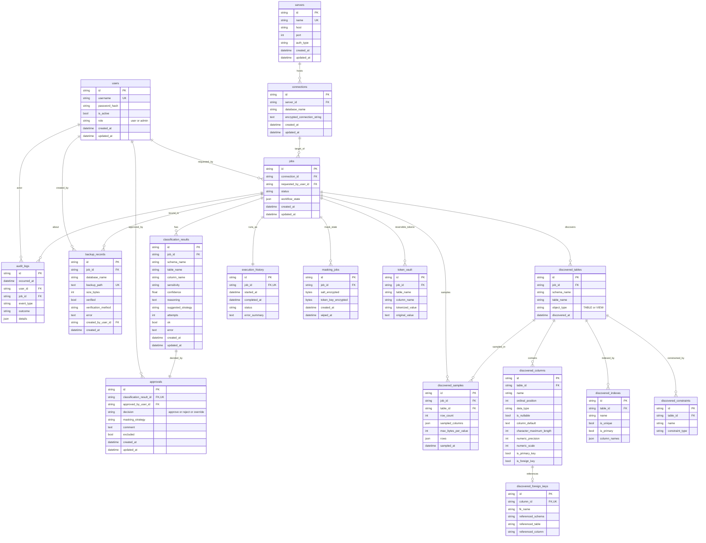

# Database Design

This document describes the **application metadata database** — the
store the platform uses for its own state (users, jobs, discoveries,
approvals, backups, audit). It does **not** describe the target
databases that the platform inspects and anonymizes.

> **Two-database rule.** The application metadata database and the
> anonymization **target** MSSQL databases are strictly separate:
> * The metadata engine is built once from `DATABASE_URL`
>   (`app/database/session.py` → `get_engine`).
> * Target databases are reached only through short-lived, per-request
>   `pyodbc` connections built from the request body
>   (`app/database/url.py` → `build_mssql_url`).
> * No metadata query ever runs against a target, and no target
>   connection string is persisted in plaintext (stored connection
>   strings are Fernet-encrypted, see `Connection.encrypted_connection_string`).
>   In local development the two may *physically* live on the same
>   SQL Server instance, but they are always logically distinct
>   connections with distinct lifecycles.

The metadata engine is SQLAlchemy 2.0 (declarative, `Mapped[...]`
style) with Alembic migrations. All primary keys are application
UUIDv4 strings (`String(36)`), so IDs are stable across engines and
portable between SQLite (dev/test) and MSSQL/SQL Server (production).

---

## Entity–relationship diagram



---

## Tables

### Identity & authorization

#### `users`
Application accounts. Passwords are stored only as Argon2 hashes
(`pwdlib`); the plaintext is never persisted or logged.

| Column | Type | Notes |
|---|---|---|
| `id` | String(36) | PK |
| `username` | String(128) | **UNIQUE**, indexed |
| `password_hash` | String(512) | Argon2 hash |
| `is_active` | Boolean | inactive users are rejected at token verification |
| `role` | String(32) | `user` \| `admin` (default `user`) |
| `created_at` / `updated_at` | DateTime(tz) | timestamps |

Home of the `role`-based authorization checks enforced by
`app/security/deps.py`.

### Target registration

#### `servers`
A registered target SQL Server host.

| Column | Type | Notes |
|---|---|---|
| `id` | String(36) | PK |
| `name` | String(128) | **UNIQUE** |
| `host` | String(255) | |
| `port` | Integer | default `1433` |
| `auth_type` | String(32) | e.g. `sql` |
| `created_at`/`updated_at` | DateTime(tz) | |

#### `connections`
A (server, database) pair with its **encrypted** connection string.

| Column | Type | Notes |
|---|---|---|
| `id` | String(36) | PK |
| `server_id` | String(36) | FK → `servers.id`, indexed |
| `database_name` | String(128) | |
| `encrypted_connection_string` | Text | Fernet ciphertext |
| `created_at`/`updated_at` | DateTime(tz) | |

**Constraint:** `UNIQUE(server_id, database_name)` (`uq_connection_database`).

### Workflow

#### `jobs`
One discovery → anonymization run. `workflow_state` stores the
current phase of the state machine (see `docs/ARCHITECTURE.md`).

| Column | Type | Notes |
|---|---|---|
| `id` | String(36) | PK |
| `connection_id` | String(36) | FK → `connections.id`, indexed |
| `requested_by_user_id` | String(36) | FK → `users.id`, indexed |
| `status` | String(32) | indexed |
| `workflow_state` | JSON | phase + metadata |
| `created_at`/`updated_at` | DateTime(tz) | |

#### `classification_results`
One persisted classification of one table/column by the LLM. Failed
classifications are stored with `ok = false` and the parser error so
nothing is silently dropped.

**Constraint:** `UNIQUE(job_id, schema_name, table_name, column_name)`
(`uq_classification_result_column`) — re-classification **upserts**.

#### `approvals`
The single human decision for a classification. **Constraint:**
`UNIQUE(classification_result_id)` — at most one approval per
classification.

| Column | Type | Notes |
|---|---|---|
| `classification_result_id` | String(36) | FK → `classification_results.id`, indexed, **UNIQUE** |
| `approved_by_user_id` | String(36) | FK → `users.id`, indexed |
| `decision` | String(32) | `approve` \| `reject` \| `override` |
| `masking_strategy` | String(64) | nullable (override) |
| `comment` | Text | nullable |
| `excluded` | Boolean | column excluded from masking |

#### `execution_history`
One row per job execution. **Constraint:** `UNIQUE(job_id)`.

#### `backup_records`
Durable record of every `BACKUP DATABASE` attempt (success **and**
failure). The safe-update gate requires a `verified = true` row for
the supplied `backup_path` before any target data is modified.

| Column | Type | Notes |
|---|---|---|
| `job_id` | String(36) | FK → `jobs.id`, nullable, indexed |
| `database_name` | String(128) | indexed |
| `backup_path` | Text | **UNIQUE** (`uq_backup_record_path`) |
| `size_bytes` | Integer | |
| `verified` | Boolean | `true` only after `RESTORE VERIFYONLY` |
| `verification_method` | String(64) | nullable |
| `error` | Text | nullable |
| `created_by_user_id` | String(36) | FK → `users.id`, nullable |
| `created_at` | DateTime(tz) | |

### Discovery (read-only metadata about the target)

* **`discovered_tables`** — `UNIQUE(job_id, schema_name, table_name)`.
* **`discovered_columns`** — `UNIQUE(table_id, name)`; FK →
  `discovered_tables.id`.
* **`discovered_foreign_keys`** — `UNIQUE(column_id)`; FK →
  `discovered_columns.id`. Outbound FK target (`referenced_schema`,
  `referenced_table`, `referenced_column`).
* **`discovered_indexes`** — `UNIQUE(table_id, name)`; `column_names`
  is a JSON list preserving index column order.
* **`discovered_constraints`** — `UNIQUE(table_id, name,
  constraint_type)`; covers CHECK/UNIQUE (PK/FK live in their own
  tables).
* **`discovered_samples`** — `UNIQUE(job_id, table_id)`; each row is a
  dict of `{column: {value, truncated, original_length}}`, capped at
  `max_bytes_per_value`.

### Masking

#### `masking_jobs`
Per-job masking secrets, encrypted with the application-level
`CREDENTIAL_ENCRYPTION_KEY`. `wiped_at` marks an irreversible wipe.

| Column | Type | Notes |
|---|---|---|
| `job_id` | String(36) | FK → `jobs.id`, indexed |
| `salt_encrypted` | bytes | encrypted per-job salt |
| `token_key_encrypted` | bytes | encrypted per-job token key |
| `created_at` | DateTime(tz) | |
| `wiped_at` | DateTime(tz) | nullable; set on wipe |

#### `token_vault`
Reversible `token → original` mapping for the `Tokenization` strategy,
valid only **before** the token key is wiped.
**Constraint:** `UNIQUE(job_id, table_name, column_name,
tokenized_value)`.

### Audit

#### `audit_logs`
Append-only operational event stream. The application provides **no
update or delete path** (see `app/agents/audit.py`). `details` is a
JSON payload that is central-sanitized before persistence
(`app/security/redaction.py`).

| Column | Type | Notes |
|---|---|---|
| `occurred_at` | DateTime(tz) | indexed |
| `user_id` | String(36) | FK → `users.id`, nullable |
| `job_id` | String(36) | FK → `jobs.id`, nullable |
| `event_type` | String(64) | indexed (e.g. `auth.login`, `safe_update.complete`) |
| `outcome` | String(32) | e.g. `success` \| `failure` |
| `details` | JSON | sanitized |

---

## Relationship summary

| Parent | Child | Cardinality | FK |
|---|---|---|---|
| `users` | `jobs` | 1 → * | `jobs.requested_by_user_id` |
| `users` | `approvals` | 1 → * | `approvals.approved_by_user_id` |
| `users` | `audit_logs` | 1 → * | `audit_logs.user_id` (nullable) |
| `users` | `backup_records` | 1 → * | `backup_records.created_by_user_id` (nullable) |
| `servers` | `connections` | 1 → * | `connections.server_id` |
| `connections` | `jobs` | 1 → * | `jobs.connection_id` |
| `jobs` | `classification_results` | 1 → * | `classification_results.job_id` |
| `jobs` | `discovered_tables` | 1 → * | `discovered_tables.job_id` |
| `jobs` | `discovered_samples` | 1 → * | `discovered_samples.job_id` |
| `jobs` | `audit_logs` | 1 → * | `audit_logs.job_id` (nullable) |
| `jobs` | `backup_records` | 1 → * | `backup_records.job_id` (nullable) |
| `jobs` | `execution_history` | 1 → 1 | `execution_history.job_id` (unique) |
| `jobs` | `masking_jobs` | 1 → * | `masking_jobs.job_id` |
| `jobs` | `token_vault` | 1 → * | `token_vault.job_id` |
| `classification_results` | `approvals` | 1 → 1 | `approvals.classification_result_id` (unique) |
| `discovered_tables` | `discovered_columns` | 1 → * | `discovered_columns.table_id` |
| `discovered_tables` | `discovered_indexes` | 1 → * | `discovered_indexes.table_id` |
| `discovered_tables` | `discovered_constraints` | 1 → * | `discovered_constraints.table_id` |
| `discovered_tables` | `discovered_samples` | 1 → * | `discovered_samples.table_id` |
| `discovered_columns` | `discovered_foreign_keys` | 1 → 0..1 | `discovered_foreign_keys.column_id` (unique) |

---

## Constraints & indexes (at a glance)

**Unique constraints**
`users.username`, `servers.name`,
`connections(server_id, database_name)`,
`classification_results(job_id, schema_name, table_name, column_name)`,
`approvals.classification_result_id`,
`execution_history.job_id`,
`backup_records.backup_path`,
`discovered_tables(job_id, schema_name, table_name)`,
`discovered_columns(table_id, name)`,
`discovered_foreign_keys.column_id`,
`discovered_indexes(table_id, name)`,
`discovered_constraints(table_id, name, constraint_type)`,
`discovered_samples(job_id, table_id)`,
`token_vault(job_id, table_name, column_name, tokenized_value)`.

**Indexed columns**
`users.username`; `jobs.connection_id`, `jobs.requested_by_user_id`,
`jobs.status`; `classification_results.job_id`;
`approvals.classification_result_id`, `approvals.approved_by_user_id`;
`audit_logs.occurred_at`, `audit_logs.event_type`;
`execution_history.job_id`; `backup_records.job_id`,
`backup_records.database_name`; all `discovered_*` FK columns;
`masking_jobs.job_id`; `token_vault.job_id`.

There are **no database-level `ON DELETE CASCADE` rules**: deletions
are intentionally explicit in application code, so an audit/history
row can never be silently cascaded away.

---

## Migration history

The schema is built by Alembic (`backend/migrations/versions/`). Run
`alembic upgrade head` to reach the current head `20261015_0008`.

| Revision | Description |
|---|---|
| `20260722_0001_initial_metadata` | `users`, `servers`, `connections`, `jobs`, `classification_results`, `approvals`, `audit_logs`, `execution_history` |
| `20260723_0002_discovered_schema` | `discovered_tables`, `discovered_columns`, `discovered_indexes`, `discovered_constraints`, `discovered_foreign_keys` |
| `20260723_0003_discovered_samples` | `discovered_samples` |
| `20260723_0004_classification_result_upsert` | upsert uniqueness on `classification_results` |
| `20260723_0005_approvals_unique` | `UNIQUE(classification_result_id)` on `approvals` |
| `20260723_0006_masking_jobs` | `masking_jobs`, `token_vault` |
| `20260723_0007_user_role` | `users.role` (RBAC) |
| `20261015_0008_backup_records` | `backup_records` (verified-backup gate) |

---

## Inspecting the schema

```bash
cd backend

# Show the current revision
alembic current

# Walk the full migration history
alembic history --verbose

# Recreate the schema from scratch on any empty database
alembic upgrade head
```

For an ad-hoc description of every table/column/FK/index, the ORM
models in `app/models/entities.py` are the single source of truth;
the Alembic migrations mirror them exactly.
